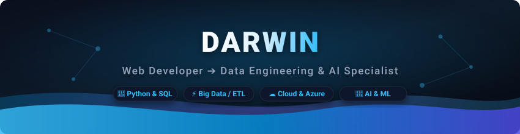

<!-- HEADER BANNER -->

  

<!-- TYPING ANIMATION -->

  

---

### 👨‍💻 Sobre mí

Graduado en **Desarrollo de Aplicaciones Web (DAW)** y actualmente especializándome a través del **Máster en Inteligencia Artificial y Data Engineering en Tajamar** (2026 – 2027).

Mi objetivo es fusionar mi experiencia en desarrollo de software con el ecosistema de **Big Data, arquitectura de datos (ETL/ELT), Cloud e Inteligencia Artificial**, transformando datos brutos en sistemas inteligentes y soluciones eficientes.

---

### 🎯 Áreas de Enfoque

<table>
  <tr>
    <td width="33%" align="center">
      <h3>💻 Software & Web</h3>
      
Desarrollo backend y frontend robusto, arquitectura de software, bases de datos y creación de APIs.

    </td>
    <td width="33%" align="center">
      <h3>📊 Data Engineering</h3>
      
Diseño y orquestación de pipelines ETL/ELT, procesamiento distribuido con PySpark, Data Lakehouse y Cloud.

    </td>
    <td width="33%" align="center">
      <h3>🤖 Inteligencia Artificial</h3>
      
Machine Learning, sistemas multiagente, IA Generativa y despliegue de soluciones con Azure AI & Copilot.

    </td>
  </tr>
</table>

---

### 🛠️ Tech Stack

#### Lenguajes & Backend

  

#### Data Engineering, Big Data & Cloud

  

  
  
  
  
  

#### Web & Herramientas

  

---

### 📈 GitHub Analytics

  
   
  

---

### 📬 Conectemos

 

> *“Always learning, always building.”* 🚀

 

